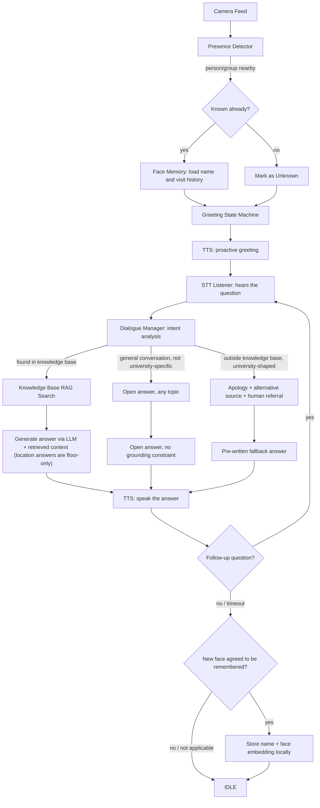
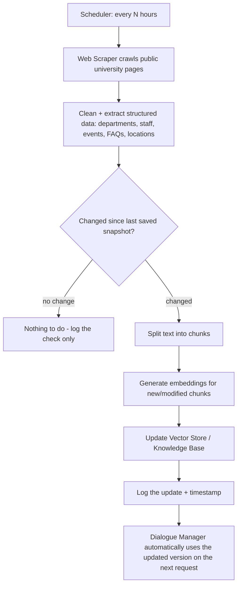

# Architecture + Data Workflow

This document explains the **entire** system flow: the real-time interaction with a student, and
the background university data update flow.

## 1) Components (Modules)

| Module | Role | Corresponds to |
|---|---|---|
| Presence Detector | Detects a person/group in front of the camera and estimates proximity | Stage 01 |
| Face Memory | Recognizes a known face / registers a new face with consent | Stage 02 |
| Persistent Memory (MySQL) | Stores enrolled people, their face embeddings, and every conversation transcript, so all of it survives a restart | Stage 02 (`robot_db.py`) |
| Greeting State Machine | Decides when to proactively greet and with what phrasing | Stage 03 |
| STT Listener | Converts heard speech to text (streaming + VAD) | Stage 04 |
| Dialogue Manager (NLU+RAG+LLM) | Understands intent, answers from the knowledge base or apologizes | Stage 05 |
| Answer Backend Chain | Cloud LLM → local LLM (Ollama) → knowledge-base text, so one backend failing costs a retry rather than a wrong answer | Stage 05 (`dialogue_manager_live.py`) |
| Knowledge Base (Vector Store) | Stores university data text/chunks as embeddings for search | Stage 05 |
| TTS Speaker | Converts the answer text to audible speech | Stage 06 |
| Expression Layer (Face) | Shows the robot's state (animated screen face or physical head) | Overlaps 03/06 |
| University Data Pipeline | Scraper + Diff + Indexer, running on a periodic schedule | Stage 07 |
| Orchestrator | The main loop (state machine) tying everything together | Stage 08 |
| Logging/Monitoring | Logging, errors, performance monitoring, auto-restart | Stage 09 |

There's deliberately no dedicated wayfinding/in-building-routing module. A department or service's
floor is just another fact in the Knowledge Base (e.g. "the Engineering department is on the
third floor"), answered through the same grounded RAG path as any other university question - a
floor number is enough, so a separate stage to generate step-by-step routes wasn't worth the
added surface area.

## 2) Real-time Interaction Workflow



## 3) Background University Data Workflow

This is a **fully independent** flow that runs in the background, unrelated to the moment of
interacting with a student:



**Important note**: the Knowledge Base is the same source the robot reads from and updates —
there's no separate manual copy that someone needs to maintain; every update on the official
university website is reflected automatically within, at most, the scheduling interval.

## 2b) Answering without depending on anyone's API

Two separate things can produce an answer, and each has a local option so neither is a single
point of failure:

```
                          RETRIEVAL                              GENERATION
                    (which facts are relevant)              (turning them into a sentence)

  question ──> embed the query ──> cosine search ──> chunks ──> 1. cloud LLM  (Gemini/Groq)
                     │                                          2. local LLM  (Ollama)
                     ├─ sentence-transformers (default,         3. the chunk, spoken verbatim
                     │  in-process, offline)
                     └─ Ollama nomic-embed-text (optional)
```

**Generation** is a fallback chain, and it exists because of two real failures in this project:
a Gemini 503 mid-answer and a 429 on the first question of a session.
Each one ended with the robot reading a raw scraped page-title fragment aloud as though it were
an answer. A local model can't 503, can't exhaust a free tier, and doesn't need the network — so
when the cloud call fails, the question is simply asked again locally. Cloud stays first because
Gemini can search the live web, which matters for a smaller institution whose details a model's
training data barely covers.

Every failover is logged with the backend's name. A chain that downgraded silently would make a
weak local answer indistinguishable from a strong cloud one when reading the log afterwards, and
would hide the API problem the operator needs to fix.

**Retrieval** is not a chain — the default embedding model already runs in-process and offline,
so there is nothing to fail over to. Ollama is offered there as an accuracy option
(`nomic-embed-text` handles paraphrased questions better, and a spoken question is nearly always
a paraphrase), not an availability one. Because a similarity threshold is only meaningful for
the model it was measured on, `SIMILARITY_THRESHOLDS` is keyed by model and an unmeasured model
warns on every startup rather than silently borrowing another model's number.

The two shortest paths bypass generation entirely and are the ones most questions actually take:
`identity.py` answers "who made you" from a string lookup, and a curated directory chunk marked
`is_direct_answer` is already a finished spoken sentence, so it is spoken as-is. Neither needs
any model at all. The identity strings themselves are read from MySQL (`robot_identity`) once at
startup, never per question — the robot's own name is data, but a visitor must never wait on a
query to hear it, and a database outage falls back to a local cache rather than to a stale name
baked into the source.

## 3b) Persistent memory (MySQL)

There are two completely separate stores, and it's worth being explicit about which is which,
because "the robot's memory" could reasonably mean either:

| | Knowledge Base (Stage 05/07) | Persistent Memory (Stage 02) |
|---|---|---|
| Holds | What the university publishes | Who the robot has met, and what was said |
| Source | Scraped automatically from the website | The people standing in front of it |
| Storage | Vector store + on-disk `kb_cache.npz` | MySQL |
| If lost | Rebuilds itself on the next scrape | Gone — students have to re-introduce themselves |

The MySQL side, in five tables:

```
robot_identity                 (who the robot is - name, creator, email, nationality)
people ──┬── face_embeddings   (1..5 float32 vectors per person)
         └── conversations ──── utterances   (the transcript, one row per spoken line)
```

Two things about the shape of this are deliberate:

- **`conversations.person_id` is nullable.** A visitor who declined to be remembered still has
  their visit recorded, just with no identity attached — the usage record survives without
  costing anyone their privacy.
- **Every foreign key is `ON DELETE CASCADE`.** Deleting a person deletes their embeddings,
  their conversations and their transcripts in one statement. That's what makes PRIVACY.md's
  retention policy and right-to-be-forgotten a property of the schema rather than a procedure
  someone has to remember to follow.

Recognition itself does **not** query MySQL. The store is loaded into memory once at startup and
compared there, several times a second; MySQL is the durable record, not the matching index.
Writes go the other way — a new enrollment, a visit count, a spoken line — and every one of them
is best-effort: if the database is unreachable the robot still greets, listens and answers, and
says loudly at startup that this session will be forgotten (Stage 09's graceful-degradation
rule). See `robot_db.connect_or_none()`.

## 4) Static data that must be entered manually (once, or rarely)

The following **is not extracted from the public website** because it usually either isn't
published there or requires high accuracy:

- Which floor each department/service is on → university websites rarely publish an accurate
  internal floor directory, so this is curated by hand as ordinary Knowledge Base chunks (Stage
  05's `SAMPLE_CHUNKS`, eventually merged with whatever Stage 07's scraper can find), not a
  separate stage or file. Deliberately floor-only, no rooms/elevators/step-by-step routes - see
  the note under section 1.

## 5) Expression/Face Layer — decision deferred

Since it isn't decided yet whether it's an animated screen face or a physical animatronic head,
it's designed as a single interface:

```
ExpressionController.set_state(state: Idle|Listening|Thinking|Speaking|Greeting)
```

Any implementation (an animated screen, or servo commands for a physical head) implements the
same interface, so the rest of the system is unaffected when that decision is eventually made.

## 6) Language Layer

First stage: **English only** (STT + NLU + TTS + Knowledge Base in English). The design separates
"dialogue logic" from "the language used" (a locale code is passed to every module), so adding
Arabic/Chinese later means adding a new STT/TTS model + translating the knowledge base, without
touching the Orchestrator.
